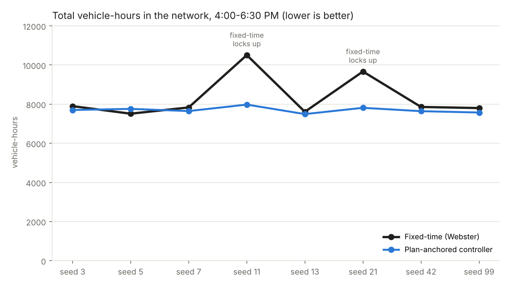
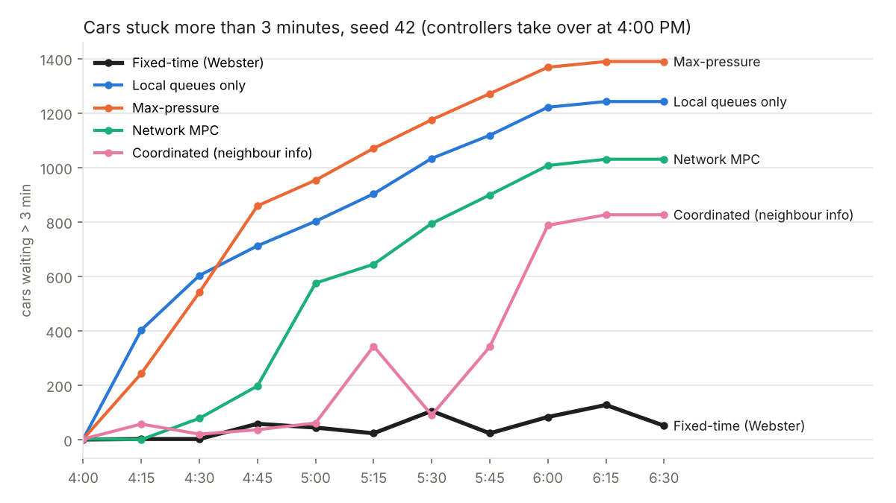
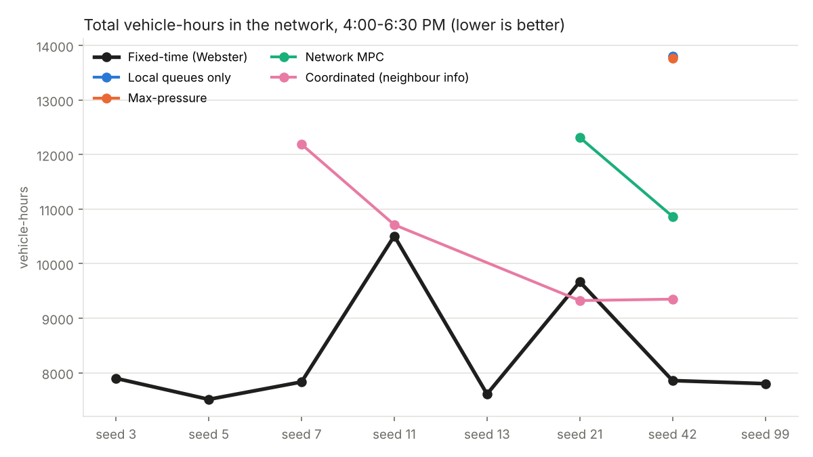

# Controller comparison on baseline-v2 (Nov 21-22)

Question: **how much shared information does a signal controller need to
reduce delay and stop the interchange from gridlocking?**

All runs use the same baseline-v2 network and demand, 3:45-6:30 PM, 0.2 s
steps, the same driver settings, and cars are never removed
(`--time-to-teleport -1`). Collisions inside junctions are also counted
(`--collision.check-junctions true`), which `check_run.py` did not do.
Controllers run the fixed-time plan during the 15-minute warm-up and take
over at 4:00 PM, the same as `evaluate_controller.py`.

## New controller: plan-anchored (Nov 22)

The comparison below (Nov 21) showed that every controller we had re-chose
the phase every 5 s, switched more often than fixed-time, gave green time to
the wrong phases, and did worse than the Webster plan. So the new controller
(`simulation/anchored_controller.py`, `--policy anchored`) does not replace the
plan. SUMO keeps running the Webster plan itself (same phases, green times,
yellow, all-red and offsets), and the controller only shortens, lengthens or
skips a green when it has a reason:

| Rule | When | What it does |
|---|---|---|
| Rest | nobody waits on red (including a car waiting for a red turn on a green lane) | keeps the current green on instead of cycling through empty phases |
| Gap-out | the green has no queue and no car arriving within 10 s, cars wait on red, at least half the planned green is used | ends the green early |
| Blocked exit | every queued car on green goes to a road that is full (2 readings in a row) | ends the green; the time goes to the other approaches |
| Spillback guard | a green queue fills 85% of its road while every red queue is under 50% | extends the green (up to +50%, at most 30 s) |
|  | a red queue fills 85% while the green queue is under 50%, after 70% of the plan | ends the green |
| Skip | a green starts with nobody waiting or arriving while cars wait elsewhere | jumps to the next green |

**Short links.** Roads between two close junctions that hold fewer than 8
cars get extra care: their cars come in platoons from the signal just
upstream, and any queue there blocks that signal. Their greens never gap out,
are never skipped, and are not cut for spillback while they still move cars.

**Signals that keep the plan.** Four signals are joined to another signal by
a road of fewer than 4 cars (about 25 m): the junction under I-278, Astoria
Blvd / 31st St N and S, and the signal next to Astoria Blvd / 33rd St
(`cluster_6406731015…`). The plan's offsets time each pair together, so the
controller leaves these four on the plan and adapts the other 32 signals.
The controller finds them from the network (`tightly_linked`); nothing is
hard-coded.

**What each signal uses:** its own approach queues and arriving cars (like
loop detectors), and how full the roads after it are (shared by the next
signal). It takes over at 4:00 PM like the other controllers.

### How we got here (bugs found by testing, each now has a unit test)

| Version | Change | Seeds that clear | What went wrong |
|---|---|---|---|
| 1 | the 5 rules | 42, 21 | the SB green under I-278 gapped out between platoons from Astoria Blvd N; the short link filled and the off-ramp backed up (seeds 7, 11 locked by 4:25). Also: a straight green rested forever while a left-turner waited on the same lane (fixed in this version) |
| 2 | short links never gap out or get skipped; small queues on them count | 7 of 8 (all but 42) | the junction under I-278 cut its SB green 107 times and Astoria Blvd N 68 times for spillback, because 1-2 cars on a 3.5-car link looked like a "small" queue; seed 42 locked at 5:15 |
| 3 | no spillback cut while a green moves cars off a short link | 42 and 11 both lock (6:00, 5:30) | fixing one green moved the problem to the next signal: these signals are timed as a group |
| 4 (current) | the four tightly linked signals keep the plan | see table | seed 11 now jams on a different chain of signals about 65 m apart (`-954569523`, `905190094`, `905190092`) around 5:45-6:00 |

The collisions near some locks (for example a truck turning left at Astoria
Blvd N at 5:07 PM on seed 42, version 2) came after the queue had already
formed, and a version 2 run with 12 collisions still cleared, so the
collisions did not cause the locks.

`test_anchored_controller.py` has 20 tests (no SUMO needed); all pass, and
the 31 existing tests in `test_adaptive_controller.py` still pass.

### Results (version 4) on all 8 seeds

| Seed | Fixed-time: arrived / veh-h / result | **Plan-anchored v4**: arrived / veh-h / result | Change in veh-h | Collisions (fixed / v4) | v2 (earlier): veh-h / result |
|---|---|---|---|---|---|
| 42 | 11,455 / 7,857 / clears | 11,500 / 7,640 / clears | -3% | 16 / 24 | 8,882 / locks ~5:15 |
| 7 | 11,389 / 7,832 / clears | 11,573 / 7,646 / clears | -2% | 28 / 10 | 7,024 / clears |
| 3 | 11,389 / 7,898 / clears | 11,506 / 7,700 / clears | -3% | 32 / 26 | 7,062 / clears |
| 5 | 11,682 / 7,512 / clears | 11,477 / 7,759 / clears | +3% | 28 / 22 | 7,076 / clears |
| 13 | 11,548 / 7,610 / clears | 11,705 / 7,492 / clears | -2% | 22 / 22 | 7,134 / clears |
| 99 | 11,432 / 7,800 / clears | 11,634 / 7,573 / clears | -3% | 24 / 38 | 6,964 / clears |
| 21 | 8,732 / 9,668 / locks ~5:15 | 10,574 / 7,812 / locks ~5:45 | -19% | 12 / 18 | 6,959 / clears |
| 11 | 8,175 / 10,508 / locks ~5:00 | 10,545 / 7,977 / locks ~6:00 | -24% | 6 / 18 | 7,036 / clears |



What the results say:

1. **On the 6 evenings where fixed-time clears, the new controller also
   clears and uses 2-3% fewer vehicle-hours on 5 of them** (seed 5 is 3%
   worse: 7,759 vs 7,512). This is the first controller in our study that does
   about as well as or better than the Webster plan on these evenings; every
   Nov 21 controller locked up on seeds 42 and 7.
2. **On the 2 evenings where fixed-time locks up (21 and 11), it gets about
   1,850-2,370 more cars to their destination and uses 19-24% fewer
   vehicle-hours,** and the lock comes 30-60 minutes later (around 5:45-6:00
   instead of 5:00-5:15). It does not prevent the lock yet.
3. **Version 2 (interchange signals adaptive) was better than version 4 on 7
   of 8 seeds** (about 7,000 vehicle-hours vs about 7,500-7,800) and cleared
   21 and 11, but locked seed 42 at 5:15. Keeping the four tightly linked
   signals on the plan made the controller safe on seed 42 but gave up most of
   the gain. So most of the gain comes from adapting the interchange itself,
   and the open problem is doing that without breaking the timing between its
   signals.
4. **Collisions:** about the same as fixed-time (10-38 colliding cars per
   evening vs 6-32), all inside junctions, and some before 4:00 PM when every
   run is still on the fixed plan. See Collisions below.
5. Over all 8 seeds, vehicle-hours are 6.5% lower on average than fixed-time
   (mean of the per-seed changes).

### Next steps for this controller

- Seed 11 jams on the chain of signals along `-954569523` / `905190094`
  (gaps of about 9 cars). Try keeping signals joined by roads under about
  10 cars on the plan too (`TIGHT_LINK`), or coordinate each chain as one
  unit (shift a whole chain's greens together, keeping the offsets), and
  check seed 11 first, then all 8 seeds.
- Version 2 kept the interchange signals adaptive and gave the lowest
  vehicle-hours on the seeds it cleared (about 7,000 vs 7,500-7,900 for
  fixed-time). A version that adapts the interchange as one group (keeping
  the offsets between its four signals) may get both: no lock and the bigger
  gain.

## The controllers (least to most information)

| Policy | Family | What each signal knows | How it decides |
|---|---|---|---|
| `webster` | none | nothing (no sensors) | fixed green times from Webster's method |
| `fixed` | adaptive | nothing | same green times, rebuilt as protected-only phases |
| `local` | adaptive | its own approach queues | serves the phase with the most benefit at its own signal |
| `coordinated` | adaptive | + neighbours' plans and free space downstream | same, but reserves room downstream and predicts arrivals from neighbours |
| `int-local` | intelligent | its own queues (whole network adapts) | capacity-aware pressure with forecasts, imported SUMO phases |
| `int-coordinated` | intelligent | + neighbours' plans and free space downstream | same, plus reserving downstream room and predicting arrivals from neighbours |
| `max_pressure` | intelligent | own queue and the queue right downstream | serves the phase with the largest queue difference (Varaiya 2013) |
| `mpc` | network MPC | a model of the whole network | searches future signal schedules for all signals together, 30 s ahead |

The adaptive family (`fixed`, `local`, `coordinated`) only controls signals
within 5 signals / 650 m of the three centre signals; the intelligent family
and MPC control every signal in the map.

## Files

| File | What it is |
|---|---|
| `compare_controllers.py` | Runs one policy for one evening and writes a result file |
| `summarize_results.py` | Collects all result files into `controller_results.csv` and draws the charts |
| `results/<policy>_<seed>.json` | One result file per run |
| `controller_results.csv` | All runs in one table |
| `controller_stuck_seed42.png`, `controller_vehicle_hours.png`, `anchored_vs_fixed.png` | The charts in this file |
| `../anchored_controller.py`, `../test_anchored_controller.py` | The plan-anchored controller (new file; no existing controller code changed) and its 20 unit tests |

The only change to existing code is `CENTRES` in `adaptive_controller.py`: it
now also lists the two new 31st St signal ids from baseline-v2 (the old ids
stay, so it still runs on the old network; all 31 unit tests pass).

## How to run

```
python simulation/baseline-v2/compare_controllers.py --policy int-coordinated --seed 42 --json simulation/baseline-v2/results/int-coordinated_42.json
python simulation/baseline-v2/summarize_results.py simulation/baseline-v2/results
```

The first controller run writes `baseline-v2-webster.net.xml` (the network
with the fixed-time plan written in) so controllers start from the same green
times as the baseline. Controller settings can be changed without editing
code, the same way as in `evaluate_controller.py`:
`TC_TUNING='{"maximum_green": 90}'`. One evening takes about 1-2 hours on one
CPU core (longer for MPC and for runs that lock up, because more cars stay on
the map).

## Results

What we measure (from 4:00 PM, when the controllers take over):

- **Vehicle-hours**: every second, count the cars on the map plus the cars
  still waiting to enter it, and add up. This is the total time all drivers
  spend in or waiting for the network. Lower is better. We use this instead of
  average delay, because when the network locks up the stuck cars never
  finish their trip, so they never appear in the average delay (a run that
  locks up can show a *smaller* average delay than a run that works).
- **Arrived**: cars that finished their trip by 6:30 PM. Higher is better.
- **Stuck at 6:30**: cars that have waited more than 3 minutes. More than 100
  means the network is locked (gridlock).
- **Off-ramp**: cars leaving the EB off-ramp per 30 minutes.

| Seed | Policy | Off-ramp 4:00 / 4:30 / 5:00 / 5:30 | Stuck at 6:30 | Arrived | Vehicle-hours | Collisions | Result |
|---|---|---|---|---|---|---|---|
| 42 | **Fixed-time (Webster)** | 327 / 275 / 324 / 365 | 51 | 11,455 | 7,857 | 16 | clears |
| 42 | Intelligent, local only | 36 / 4 / 5 / 6 | 1,242 | 6,430 | 13,810 | 0 | locked from ~4:15 |
| 42 | Max-pressure | 41 / 1 / 0 / 0 | 1,389 | 6,351 | 13,771 | 2 | locked from ~4:15 |
| 42 | Network MPC | 124 / 43 / 25 / 10 | 1,030 | 8,039 | 10,867 | 4 | locked from ~4:45 |
| 42 | Intelligent, coordinated | 268 / 135 / 42 / 50 | 826 | 9,453 | 9,350 | 4 | locked from ~5:45 |
| 42 | Intelligent, coordinated, longer greens* | 144 / 87 / 66 / 34 | 930 | 9,169 | 9,880 | 4 | locked from ~4:30 |
| 42 | Intelligent, coordinated, minimum green 25 s** | 50 / 6 / 7 / 11 | 1,223 | 6,466 | 13,733 | 0 | locked from ~4:15 |
| 7 | **Fixed-time (Webster)** | 327 / 290 / 299 / 316 | 83 | 11,389 | 7,832 | 28 | clears |
| 7 | Intelligent, coordinated | 155 / 15 / 7 / 10 | 1,157 | 7,227 | 12,188 | 8 | locked from ~4:45 |
| 7 | Intelligent, coordinated, minimum green 25 s** | 35 / 5 / 8 / 11 | 1,228 | 6,423 | 13,827 | 2 | locked from ~4:15 |
| 21 | **Fixed-time (Webster)** | 348 / 287 / 37 / 7 | 879 | 8,732 | 9,668 | 12 | locked from ~5:15 |
| 21 | Network MPC | 10 / 139 / 75 / 15 | 1,196 | 7,581 | 12,314 | 8 | locked from ~4:15 |
| 21 | Intelligent, coordinated | 137 / 91 / 70 / 26 | 714 | 9,454 | 9,324 | 4 | locked from ~6:00 |
| 11 | **Fixed-time (Webster)** | 337 / 161 / 4 / 8 | 986 | 8,175 | 10,508 | 6 | locked from ~5:00 |
| 11 | Intelligent, coordinated | 96 / 69 / 50 / 12 | 1,037 | 8,305 | 10,714 | 6 | locked from ~4:30 |
| 11 | Intelligent, coordinated, longer greens* | 100 / 25 / 0 / 0 | 1,212 | 7,167 | 12,228 | 2 | locked from ~4:30 |

\* "Longer greens" is the coordinated controller with
`TC_TUNING='{"lost_time_amortization": 3, "maximum_green": 90, "maximum_service_gap": 150}'`.
\*\* "Minimum green 25 s" is the coordinated controller with
`TC_TUNING='{"minimum_green": 25}'` (default 8 s).

Runs not in the table: the adaptive family (`fixed`, `local`, `coordinated`)
on seed 42 was stopped at about 5:05 PM because it was clearly behind: about
600 cars finished per 15 minutes from 4:15, against about 1,090 with
fixed-time. Network MPC on seeds 7 and 11 was stopped at about 5:50 PM to free
the CPU for the other runs (6,451 and 7,690 cars finished by then).





### What the results say

1. **On the evenings where fixed-time already clears (seeds 42 and 7),
   every controller we have makes the evening worse.** All of them lock up.
   The best one, the coordinated controller, ends with 19% more
   vehicle-hours than fixed-time on seed 42 (9,350 vs 7,857, 2,000 fewer
   finished trips) and 56% more on seed 7 (12,188 vs 7,832, 4,162 fewer
   finished trips).
2. **More shared information helps a lot.** On seed 42, signals that only see
   their own queues (local only, max-pressure) lock the network within 15
   minutes of taking over (about 13,800 vehicle-hours). Adding the neighbours'
   plans and free space downstream (coordinated) keeps it moving until about
   5:45 and cuts vehicle-hours by a third (9,350). Network MPC, which plans all
   signals together, sits in between (10,867). On seed 21 MPC was worse than
   fixed-time (12,314 vs 9,668 vehicle-hours, locked from about 4:15). It
   ran out of planning time often: even with 1 s per decision, 423 of its
   1,800 decisions (23%) ran past the time limit and fell back to the fixed
   plan, because several runs shared two CPU cores. So MPC is not tested
   fairly yet (see Next steps). On seed 42 the order is: own queue only < whole
   network model < neighbour information, and none of them beats a good fixed
   plan yet.
3. **Where fixed-time locks up (seeds 21 and 11), the coordinated controller
   is about even with it.** On seed 21 it gets 722 more cars to their
   destination (9,454 vs 8,732), uses 4% fewer vehicle-hours, and the final
   lock comes about 45 minutes later (6:00 instead of 5:15). On seed 11 it
   gets 130 more cars through (8,305 vs 8,175) but uses 2% more
   vehicle-hours and locks earlier (4:30 instead of 5:00). In both it lets
   far fewer cars off the EB off-ramp (about 100-140 vs 340 in the first 30
   minutes), so more of the queue waits on I-278 instead of on the streets.
   It never prevents the lock.
4. **The controllers switch more often than fixed-time.** In the first 25
   minutes on seed 42 the junction under I-278 gave 63 greens with the
   coordinated controller against 45 with fixed-time, and the average green
   was 21 s instead of 34 s. Every switch there costs 4 s of yellow and 2 s
   of all-red, so less time is spent moving cars at the bottleneck. They
   also let far fewer cars off the EB off-ramp.
5. **But simply forcing fewer switches does not fix it, and can make it much
   worse.** Allowing longer greens with a penalty for switching was worse on
   seed 42 (9,880 vehicle-hours, locked from 4:30) and locked earlier than
   fixed-time on seed 11 (4:30 vs 5:00). A 25 s minimum green for every
   phase was far worse: on seeds 42 and 7 the network locked within 15
   minutes (about 13,700-13,800 vehicle-hours, the same as signals with no
   shared information). A long minimum green also forces green time onto
   small, empty phases at every signal in the map; fixed-time gives some
   phases only about 11 s (for example 31st St / Astoria Blvd N). So the
   problem is not only how often the controllers switch, but which phases
   they give the time to. Fixed-time gets this right because its green
   times were set from the demand at each signal.

## Collisions

With junction collisions switched on, **almost every run has a few
collisions, including the fixed-time baseline** (Webster: 6-28 colliding cars per evening,
about 2 cars per collision; controllers: 0-8). They happen inside large
junctions (for example the junction under I-278 and `cluster_42802627`),
most likely when a car that entered on green has not cleared before the
cross traffic starts. The
Nov 17 baseline check said "0 collisions" because it only checked collisions
on roads, not inside junctions. SUMO only warns about these collisions and
the cars carry on, so they do not change the flow results, but they should be
reported. Longer all-red at those two junctions is the likely fix.

## Next steps

- Done Nov 22 (plan-anchored controller above): Make the controllers keep the fixed-time plan unless they have a clear
  reason to change it (for example: only lengthen or shorten a green when a
  queue is about to block a junction upstream), instead of re-deciding every
  5 seconds. Points 4 and 5 suggest the fixed-time split of green time is
  better than what the controllers choose, so it is a better starting point
  than a free choice every 5 seconds.
- Any change to minimum or maximum green should be per signal (based on its
  fixed-time greens), not one number for the whole map.
- Use the fixed-time cycle at the junction under I-278 (120 s) as the minimum
  cycle for the controllers there.
- Run MPC alone on a free CPU core (one run at a time) so it gets its full
  planning time, and check that `mpc_fallbacks` in the result is close to 0.
- Run the coordinated controller and MPC on all 8 seeds of the baseline
  (3, 5, 7, 11, 13, 21, 42, 99).
- Longer all-red at the junction under I-278 and `cluster_42802627` to remove
  the junction collisions.
