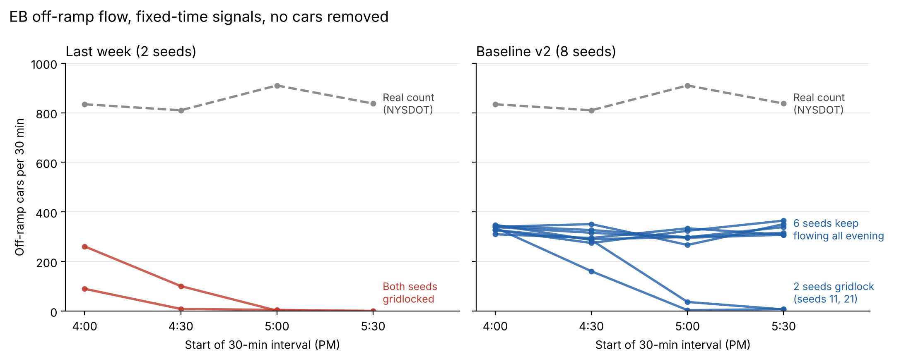

# Baseline v2: off-ramp network fixes (Nov 17)

This folder builds a fixed version of the Astoria / I-278 network and demand
so that the EB off-ramp (NYSDOT 053167) keeps flowing during the evening with
fixed-time signals, with **no removed cars (teleports) and no collisions**.
It does not change any existing repo file: the team's `astoria.net.xml`,
`astoria-corrected.net.xml` and route files are untouched. The controllers can
be pointed at `baseline-v2.net.xml` / `baseline-v2.rou.xml` when we agree to
switch.

## Files

| File | What it is |
|---|---|
| `build_network.py` | Builds `baseline-v2.net.xml` from `../astoria-osm-import/map.osm` (5 steps, listed below) |
| `site-corrections.edg.xml`, `site-corrections.con.xml` | The repo's site corrections plus the bus-lane and dead-lane fixes (used only by this build) |
| `cluster-under-i278.tll.xml` | Protected signal program (with all-red) for the junction under I-278 |
| `junction-joins.nod.xml` | Joins junction pairs that were split by 0.2-1 m road pieces |
| `make_demand.py` | Builds `baseline-v2.rou.xml` from `../astoria-osm-import/scenario-full-area.rou.xml` |
| `baseline-v2-signals.add.xml` | Fixed-time signal timing (Webster's method, see below) |
| `check_run.py` | Runs one full evening and says if the run is valid |
| `find_traps.py` | Lists car lanes that cars can enter but never leave |
| `baseline-v2.net.xml`, `baseline-v2.rou.xml` | The built network and demand |

To rebuild and check (from the repo root):

```
python simulation/baseline-v2/build_network.py
python simulation/baseline-v2/make_demand.py
python simulation/baseline-v2/check_run.py --seed 42
```

## What was fixed, and why

### Network (`build_network.py`)

1. **Turn lanes from the map.** The original import ignored OSM `turn:lanes`
   tags, so every turn lane was a guess. Re-importing with
   `--osm.turn-lanes true` corrected 23 lane connections and removed a left turn
   from Hoyt Ave S onto 31st St that does not exist (map: through x4 | right).
2. **Bus-lane trap on Hoyt Ave S (edge 25649770#1).** OSM has
   `lanes:bus:forward=1`, and the next piece already has a bus-only lane 0. The
   2.5 m piece let cars into lane 0, whose only exit is the bus lane, so they
   waited inside the junction under I-278 forever. Lane 0 is now bus-only and
   the through lanes connect 1-4 to 1-4.
3. **Dead lane on Hoyt Ave N (46139826#2 lane 3)** had no exit at all; it now
   continues into 46140174#0 lane 2. After fixes 2 and 3, `find_traps.py`
   finds only the legitimate GCP merge lane.
4. **Protected signal for the junction under I-278.** Its program let
   conflicting movements go at the same time inside one big junction, and two
   cars could block each other in the middle. The new program runs the three
   approaches one at a time with yellow and 2 s all-red.
5. **Junctions split by tiny pieces.** In six places, one real intersection
   was imported as two to five junctions joined by 0.2-1 m pieces of road (for
   example 31st St / Astoria Blvd N), and cars stopped between them. They are
   now joined into one junction each. This renames signal ids:

   | Old id(s) | New id |
   |---|---|
   | `astoria_31st_north`, `GS_5104280319` | `cluster_5104280319_7784017526_7784017558_astoria_31st_north` |
   | `astoria_31st_south` | `cluster_6406731473_astoria_31st_south` |
   | `42910587` | `cluster_42910587_4927558981_4927558982_597443952_#1more` |
   | `cluster_597443933_6406731387_6406731396_6406731415` | `cluster_6406731008_cluster_597443933_6406731387_6406731396_6406731415` |
   | `cluster_42877849_9242368762_9242368764_9242368766`, `9242368760` | `cluster_9242368760_cluster_42877849_9242368762_9242368764_9242368766` |

   `adaptive_controller.py` names `astoria_31st_north` / `astoria_31st_south`
   in `CENTRES`, so it needs the new ids to run on this network.
6. **Road pieces shorter than a car.** Astoria Blvd S before 33rd St was split
   into 4-8 m pieces at plain geometry points. SUMO cannot change lanes on a
   piece shorter than a car, so a driver in the wrong lane stopped and blocked
   both lanes. `--geometry.remove` merges these pieces (7 merges in total).

The two-lane left turn from Astoria Blvd N onto 31st St (pushed earlier) is
kept.

### Demand (`make_demand.py`)

1. **U-turn trips split.** 1,432 trips left I-278 at the EB off-ramp and got
   right back on at the WB on-ramp (37% of off-ramp cars). That was an error
   in how the demand was built. Each one is split into an off-ramp car going
   to a normal destination and an on-ramp car starting on Hoyt Ave S, which is
   where NYSDOT 053166 says WB on-ramp traffic comes from. 635 on-ramp trips
   that came round via 31st St under the highway also start on Hoyt Ave S.
2. **Looping routes removed.** 351 routes passed the same junction twice or
   were more than 30% longer than the direct path (on average about 400 m
   extra), mostly circling the block through the interchange. They now take
   the direct path. These loops were already in the original demand.
3. **Driver setting.** `lcImpatience=1`, `lcTimeToImpatience=30` (and
   `--time-to-impatience 30`): a driver blocked for 30 s accepts a smaller gap,
   instead of waiting forever.

### Signals (`baseline-v2-signals.add.xml`)

Made with SUMO's `tools/tlsCycleAdaptation.py` (Webster's method) on an
earlier version of this demand (U-turn fix applied, loop fix not yet), with a 10 s minimum green (`-g 10`) and a 60 s minimum
cycle. Then the junction under I-278 was timed by hand at a 120 s cycle
(31st St SB 57 s, NB 17 s, Hoyt 28 s, each with 4 s yellow + 2 s all-red),
because Webster's 81 s cycle gave it too little green.

## Results

`check_run.py`, full evening (3:45-6:30 PM), fixed-time signals, cars are never
removed (`--time-to-teleport -1`). "Last week" is the network on our branch
(two left-turn lanes) with the original demand and last week's Webster timing.



| Seed | Off-ramp cars per 30 min, 4:00 / 4:30 / 5:00 / 5:30 | Stuck > 3 min at 6:30 | Arrived | Collisions | Teleports | Result |
|---|---|---|---|---|---|---|
| 3 | 310 / 295 / 334 / 308 | 78 | 11,389 | 0 | 0 | clears |
| 5 | 340 / 351 / 267 / 351 | 0 | 11,682 | 0 | 0 | clears |
| 7 | 327 / 290 / 299 / 316 | 83 | 11,389 | 0 | 0 | clears |
| 13 | 339 / 316 / 296 / 308 | 0 | 11,548 | 0 | 0 | clears |
| 42 | 327 / 275 / 324 / 365 | 51 | 11,455 | 0 | 0 | clears |
| 99 | 344 / 327 / 298 / 339 | 23 | 11,432 | 0 | 0 | clears |
| 11 | 337 / 161 / 4 / 8 | 986 | 8,175 | 0 | 0 | gridlock from ~4:50 |
| 21 | 348 / 287 / 37 / 7 | 879 | 8,732 | 0 | 0 | gridlock from ~5:05 |
| Last week, seed 42 | 90 / 9 / 5 / 1 | 1,438 | 6,188 | 0 | 0 | gridlock from ~4:10 |
| Last week, seed 7 | 261 / 101 / 2 / 0 | 1,366 | 7,016 | 0 | 0 | gridlock from ~4:40 |
| Real (NYSDOT 053167) | 834 / 810 / 910 / 837 | | | | | |

- 8 of 8 runs have no collisions and no teleports. 6 of 8 keep the off-ramp
  flowing all evening and clear after demand ends; 2 of 8 still gridlock
  around 5 PM. Last week both seeds gridlocked in the first hour.
- In the runs that clear, the off-ramp carries about 300-350 cars per 30 min,
  **about 38% of the real count**.
- Why it is not higher: the off-ramp queue reaches back onto I-278. At 4:15 PM
  lane 0 of the I-278 EB link before the ramp (25346083) holds about 48 cars
  crawling at 1-3 m/s over its whole 490 m, and new off-ramp cars cannot even
  enter the map (about 2,100 are still waiting to enter at 6 PM; about 4,400
  cars in total, including Hoyt Ave S). In our demand 84% of off-ramp cars
  turn left onto 31st St under the highway, so the ramp can only empty as fast
  as that left turn and the next signal (31st St / Astoria Blvd S) pass cars.
  Using SUMO's fastest insertion settings (`departPos="last"`,
  `departSpeed="max"`) changed nothing, so this is a real queue, not an
  insertion setting.

## What did not help

Global protected left-turn layout; `--tls.ignore-internal-junction-jam`; longer
Webster cycles (90/120 s for all signals); the standard lane-change model; one
joint signal for the three 31st St junctions; fewer left turns; 70-80% demand
(locked earlier); removing background traffic (locked at once); a 150 s
coordinated pair at 31st St; giving the 33rd St bridge more green at the ramp
end (fixed one seed, broke another); `--ignore-junction-blocker` (about 170
collisions).

## Still open

- The off-ramp carries about 38% of the NYSDOT count (see Results). To get
  closer we need two facts from the real site: the real signal timing at
  Astoria Blvd N / 31st St and at Astoria Blvd S / 31st St (NYC DOT), and how
  many off-ramp drivers really turn left onto 31st St (84% in our demand).
- 2 of 8 seeds still gridlock. The lock is the block around the interchange:
  Astoria Blvd N -> left onto 31st St under I-278 -> Astoria Blvd S -> 33rd St
  bridge (one-way north, all lanes turn left) -> Astoria Blvd N. When all four
  sides fill at once, nothing can move. In the runs we traced, the stuck cars
  wait in normal queues on the roads around the block, not inside a junction
  or in a dead-end lane, so this is a real traffic pattern, and it is exactly what an
  adaptive controller with shared queue information should prevent, so the
  controller comparison can report how many seeds each controller keeps
  clear.
- The signal id renames (fix 5) mean controller code and configs that name
  the old ids need updating before they run on this network.
